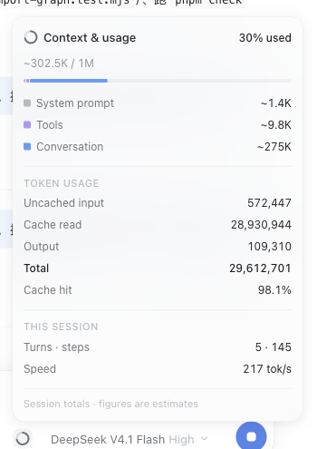

# dsh-composer-hud

DeepSeek Harness 的客户端插件：把输入框下方那一排统计收成一个**圆环**，放在模型名称左侧。圆环不显示文字，点击后打开一个面板，集中展示上下文占用、token/cache 和本次会话统计。

对应 "AIO" 版本：上下文、token、cache 合并到一个入口，不再分别占位。


## 显示效果

```text
＋  Workspace Write        ◔   DeepSeek V4.1 Flash High ⌄   ➤
```

- 圆环在模型选择器**左侧**，只画剩余上下文比例，不显示百分比、token 数或文字。
- 剩余 ≥ 75% 为灰色，≤ 25% 变黄，≤ 10% 变红。
- 悬停显示完整读数，例如 `Context left 70% · 29.3M tokens · Cache hit 98%`。
- 输入框下方原来的 `turns/steps · tok/s`、`tok · Cache hit` 和 21% 圆环会隐藏，避免重复。
- 只隐藏这三项自带统计；其它插件（例如费用 pill）仍可继续注册在 `conversation.composer.dock`。

## 点击查看明细



面板锚定在圆环上方，内容包括：

| 区块 | 内容 |
| --- | --- |
| 上下文 | 已用百分比、`~已用 / 窗口`、系统提示 / 工具 / 对话三段构成与进度条 |
| Token 用量 | 未缓存输入、缓存读取、缓存写入（非零时）、输出、合计、缓存命中 |
| 本次会话 | 轮次 · 步骤、解码速度 |

点击外部或按 `Esc` 关闭；再次点击圆环也会关闭。面板里的数字是会话累计/估算值，不发起网络请求。

## 数据来源

全部读取客户端已有的会话投影，不新增 Host 路由、不读取凭据：

| 投影 | 用途 |
| --- | --- |
| `contextPressure` | 剩余上下文比例、已用 token / 窗口 |
| `contextBreakdown` | 系统提示 / 工具 / 对话的 token 构成 |
| `tokenUsage` | 输入、缓存读取、缓存写入、输出、缓存命中 |
| `sessionStats` | 轮次、步骤、解码速度 |

## 隐藏规则

插件注册在 `conversation.input.right`，因此圆环落在模型名称左侧。它同时注入一段作用域限定的 CSS：

```css
[data-composer-dock] [data-composer-stat=activity],
[data-composer-dock] [data-composer-stat=usage],
[data-composer-dock] > span:not([data-composer-stat]) {
  display: none !important;
}
```

- 前两条对应自带的 `turns/steps · tok/s` 与 `tok · Cache hit`。
- 第三条对应自带的上下文圆环（它不是 slot entry，没有 `data-composer-stat`）。
- 隐藏只发生在 `conversation.composer.dock` 内，插件卸载时 `ctx.effect` 会移除样式。

## 安装

本目录是标准的 profile bundle：

```text
dsh-composer-hud/
├── package.json
├── cordis.patch.yml
├── lib/index.js
├── lib/client.js
├── locale/{zh,en}.json
├── icon.svg
└── README.md
```

在 Plugins → Add plugin → Install a third-party plugin 中选择本目录即可；安装后点 **Enable now**。Host 半部分是空实现，HUD 完全在 Client 运行。
