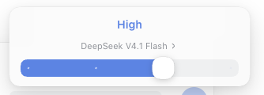
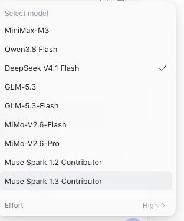

# dsh-model-effort

DeepSeek Harness 的客户端插件：把输入框的模型选择器换成一个 **Codex 风格的两页弹层**。点开默认看到思考强度，拖动滑杆即可切换 `Default / Low / High / Max`；点模型名下方的面包屑进入模型列表。





## 交互

- 触发器仍然是原来的 `DeepSeek V4.1 Flash High ⌄`，但模型名和强度分别可点。
- **点开默认进入思考强度页**，不再先经过模型列表。
- 强度页只有一个居中的蓝色当前等级、模型面包屑，以及一条可分段的滑杆：
  - 拖到任意位置会吸附到最近的档位，松开才提交一次；
  - 左右方向键也能逐档调整；
  - 左右两端各留 10px 内边距，首尾档位不会被圆角裁掉。
- 面板顶部和底部留白、圆角 18px，并带 `0 12px 32px` 的柔和阴影。
- 点面包屑（`DeepSeek V4.1 Flash ›`）进入模型列表；列表底部保留 `Effort` 行，点它回到强度页。
- 点选模型后自动回到强度页；点当前模型也会回到强度页。

## 实现

- 注册在 `conversation.input.model`，用 `priority: -1000` 遮蔽自带的选择器；卸载插件即恢复原生界面。
- 数据来自现有 `modelDirectories` 服务：`directory.store` 的 `current / groups / pending`，选择走同一个 `directory.select()`。
- 不新增 Host 服务、不写会话、不读凭据。
- 只依赖 `react`、`react-dom` 和 `@deepseek-ai/dsh-client-ui-primitives`（`MenuSurface`、图标、`StateDot`、`useAnchoredPosition`、`useDismissOnOutsidePointer`）。

## 安装

本目录是标准 profile bundle：

```text
dsh-model-effort/
├── package.json
├── cordis.patch.yml
├── lib/index.js
├── lib/client.js
├── locale/{zh,en}.json
├── icon.svg
└── README.md
```

在 Plugins → Add plugin → Install a third-party plugin 中选择本目录，安装后点 **Enable now**。Host 半部分是空实现。

## 注意

- 遮蔽的是 `conversation.input.model` 这个 single slot；如果以后 DSH 改了模型选择器的注册方式，优先检查这里的 `priority` 和 `inject`。
- 模型名不再经过 `conversation.input.model.label` 子 slot，因此其他插件给模型名加的角标不会出现在这个选择器里；模型名本身仍完整显示。
