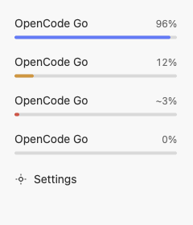
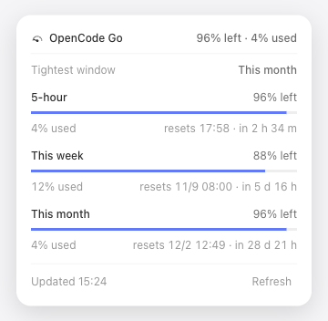

# dsh-opencode-quota

DeepSeek Harness 的本地客户端插件：在**左侧边栏底部**显示 OpenCode Go 的剩余额度。整行 42px 高、12px 圆角（hover 高亮时可见），和下方的「设置」行同高同左边界：第一行是 `OpenCode Go` 与右对齐的 `96%`，下面是一条占满整行宽度的圆头横线。点击查看 5 小时 / 本周 / 本月三个窗口的剩余、已用与重置时间。

读数不只靠颜色：跌破阈值时颜色、文字（读屏与 tooltip）和播报一起变；数据过期时百分比前加 `~`。



## 显示效果

```text
OpenCode Go              96%
━━━━━━━━━━━━━━━━━━━━━━━━━━
```

- 与侧边栏其他行同一套几何：高 42px、圆角 `--dsw-radius-md`（12px）、`margin: 6px -2px 0` + `padding: 0 10px 0 8px`，左右边界与「设置」行完全对齐。
- 横线与百分比都取三个配额窗口中**最紧张的一个**的剩余比例：`96%` 表示当前最先触顶的窗口还剩 96%。
- 横线 4px 高、两端圆头、宽度跟着侧边栏伸缩，长度即剩余比例，尽头不画刻度；第一行左侧是 `OpenCode Go`，右侧是右对齐的百分比，与横线右端对齐。收起成 rail 时只留百分比数字。悬停时通过 tooltip / `aria-label` 给出完整读数（含 `OpenCode Go` 与具体窗口）。
- 数字只有在小数真正重要时才带小数：`≥10%` 取整，`<10%` 保留一位，`<1%` 显示 `<1`——不会把 0.4% 读成 0。
- 剩余 ≤ 20% 横线变黄、≤ 5% 变红、`0` 时横线为空；同一信息同时写进 `aria-label`（「接近用完 / 即将用完 / 已用完」），跌破阈值时用 `aria-live` 播报一次，颜色只是辅助。
- 刷新失败时保留上次读数，百分比前加 `~`（如 `~3%`），tooltip 追加「数据可能已过期」。
- 没有配置 OpenCode Key 时不显示，侧边栏保持原样。
- 侧边栏收起成 56px rail 时，标签与横线隐藏，只留 36px 见方的百分比热区。

## 点击查看明细



点击这一行会打开锚定在它上方的面板：

| 内容 | 说明 |
| --- | --- |
| 标题 | `OpenCode Go` + 最紧张窗口的「剩余 X% · 已用 Y%」 |
| 最紧张的窗口 | 点名到底是哪个窗口在限制（有两个以上窗口时才显示） |
| 5-hour | 剩余百分比 + 进度条、已用百分比、重置时间与倒计时 |
| This week | 同上 |
| This month | 同上 |
| 底部 | 数据更新时间 + 手动刷新 |

- 每个窗口一条进度条，条长与主数字方向一致（都表示**剩余**），「已用」只作为次要信息放在下一行，不会出现「条在涨、字在减」的错位。
- 某个窗口用完时该行显示「已用完」，面板底部补一句「新的请求会被拒绝；{时间} 后重置。」——说清后果和出路，而不是只报一个 0。
- 点击外部或按 `Esc` 关闭；再次点击这一行也会关闭。
- 每 60 秒自动轮询；打开面板时若上次数据超过 15 秒，会立即强制刷新一次。
- 刷新失败时保留上一次读数，并在面板底部标注"刷新失败，显示上次数据"。

## 图标

面板标题左侧用的是 OpenCode 官方 logo，直接取自 [opencode.ai/brand](https://opencode.ai/brand) 的 `opencode-logo-light.svg` / `opencode-logo-dark.svg`（两份原文件存放在 `assets/`）。

内联到 `lib/client.js` 时只做了一件事：把文件里的两个 `fill` 换成 `currentColor`，内层方块用 `opacity: 0.2` 取同一颜色的淡色——在浅色主题下接近官方的 `#CFCECD`，在深色主题下接近 `#4B4646`，形状、坐标、viewBox（`0 0 240 300`）与文件完全一致，没有重画。

## 数据来源

插件分 Host / Client 两半：

| 半 | 作用 |
| --- | --- |
| `lib/index.js` | 注册 `GET /api/opencode-quota`，解析凭据并请求 OpenCode 用量接口 |
| `lib/client.js` | 注册 `sidebar.footer.action`，渲染横线读数与详情面板 |

Host 端：

- 只接受**本机回环**的 `GET`；同时校验 socket 地址与 `Host` 头。
- 通过 Harness `credentials` 服务按 `OPENCODE_GO_API_KEY` → `OPENCODE_API_KEY` 的顺序解析 Key。
- 请求 `https://opencode.ai/inference/go/v1/usage`；只有 404/405 才用同一把 Key 回退旧路径 `/zen/go/v1/usage`，401/403/429 不重试、不换 Key。
- 20 秒缓存；`?refresh=1` 绕过缓存。响应只包含窗口百分比与重置时间。
- **Key 只在 Host 内存中使用**：不写日志、不进缓存、不下发浏览器，响应里没有任何凭据。

上游返回形如：

```json
{ "usage": { "rolling": { "percent": 1, "resetsAt": "..." }, "weekly": { "percent": 0, "resetsAt": "..." }, "monthly": { "percent": 0, "resetsAt": "..." } } }
```

`percent` 是**已用**百分比，插件换算成剩余。这个接口是 OpenCode 客户端当前使用、但**未承诺稳定**的接口；上游改形状时插件会隐藏 pill 而不是显示错误数字。数字来自 OpenCode 账户，不是 DSH 账单。

## 设计依据

这套读数的取舍参考了两份公开的用量/配额 UX 归纳：

- [UI Patterns · Usage Meter](https://ui-patterns.com/patterns/UsageMeter)：给出「已用 / 上限」两个数，进度条要与文案同向；在还有余量时（约已用 80%）用平实语言提醒，说明触顶后会发生什么；红色只留给真正触顶。
- [SaaS Usage & Quota Limit UX Patterns (2026)](https://www.saasui.design/blog/saas-usage-quota-limits-ux-patterns)：每个计量维度单独一行，不要混成一个含糊的「usage」；用量要持续可见；警告必须留出可行动的余量。

据此落到本插件：

- **剩余优先**：这个入口要回答的是「我还剩多少」，所以横线、进度条、主数字都表示剩余；「已用」紧跟其后，避免只剩一个百分比时的方向歧义。
- **只有百分比，没有绝对值**：上游接口只给 `percent`，所以「上限」就是 100%，不伪造 token 数或金额。
- **点名约束**：三个窗口里最紧的那个才决定还能用多久，面板因此单独标出「最紧张的窗口」，而不是把三者平均成一个数。
- **提前说、说人话**：≤20% 就变黄（还来得及行动），≤5% 才变红；阈值变化有文字与播报，红黄不是唯一信号。

## 安装位置

- 源码：`/Users/daniel/Developer/DSH/plugins/dsh-opencode-quota`
- profile 链接：`~/.dsh/profiles/desktop/node_modules/@local/dsh-opencode-quota` → 源码目录
- bundle 注册：`~/.dsh/profiles/desktop/package.json` 的 `dsh.profile.bundles` 与 `dependencies`
- 显示名/描述：`locale/zh.json`、`locale/en.json`；图标：`icon.svg`

## 开关与卸载

在 **Plugins → Installed plugins → OpenCode quota** 里可以：

- 用开关**停用/启用整个 bundle**：停用后 pill 立即消失，重新启用后立即恢复，不需要刷新页面。
- **卸载**：先关闭插件，再从 profile 的 `dsh.profile.bundles` 移除 `@local/dsh-opencode-quota`、删除对应 `dependencies` 条目和 `node_modules/@local` 下的链接，重启 Desktop。

## 实现说明

- 走 `sidebar.footer.action` 槽，`id: opencode-quota`、`order: 1`，排在 Settings 之前；宽侧边栏显示整行，收起成 rail 时由 CSS 改成 36px 图标按钮。
- 面板的锚点定位与外部点击关闭由 `lib/client.js` 内的本地 fallback 提供（DSH 0.2.2 不再把 `@deepseek-ai/dsh-client-ui-primitives` 暴露给运行期 client bundle），经 `react-dom` 的 `createPortal` 挂到 `document.body`。
- 无障碍：触发按钮带 `aria-haspopup` / `aria-expanded` / 完整 `aria-label`；每个窗口的进度条是 `role="meter"` 并带 `aria-valuenow` / `aria-valuetext`；跌破阈值时通过 `aria-live="polite"` 播报一次，不在每次轮询时重复。
- 样式复用状态栏 pill 与内置详情面板的 `--dsw-alias-*` token，不引入自定义配色；浅色/深色主题自动跟随。
- 没有 Host 服务、工具、prompt 或设置项；`lib/index.js` 只注册一个只读端点。

## 测试

```bash
node --check lib/index.js
node --check lib/client.js
node --test test/
```

测试覆盖上游响应的解析（窗口顺序、备用字段、`used/limit` 换算、越界值钳制）、请求路径选择（404/405 回退旧路径、401/429 不重试、非法 JSON），以及客户端的展示规则（百分比格式、阈值分级、最紧张窗口选择、倒计时文案）。