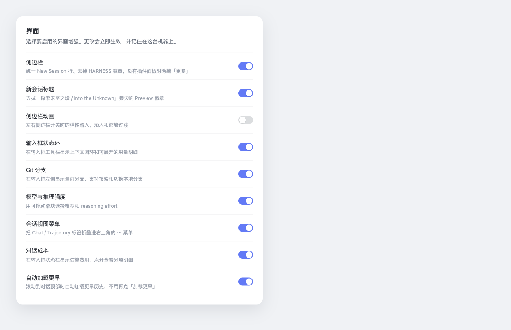

# dsh-ui-toolkit

DeepSeek Harness 的合并界面插件。原来六个独立的 UI 插件加上新会话标题清理、侧边栏动画和自动加载更早，现在是同一个 bundle 里的九个功能，在 **Settings → 界面 / Interface** 里逐项开关。

合并进来的功能：

| id | 功能 | 原来的插件 |
| --- | --- | --- |
| `sidebar` | 侧边栏统一：New Session 扁平行、去掉 HARNESS 徽章、没有插件面板时隐藏 More | `dsh-sidebar-unify` |
| `hero` | 去掉新会话标题旁边的 Preview / 预览版徽章 | 新增 |
| `motion` | 左右侧边栏开关时的弹性滑入、淡入、缩放和右侧面板边缘阴影 | 新增 |
| `composerHud` | 输入框状态环：上下文占用 + 用量明细面板 | `dsh-composer-hud` |
| `gitBranch` | 输入框左侧的 Git 分支，可搜索切换 | `dsh-git-branch` |
| `modelEffort` | 模型选择 + 可拖动 reasoning effort 滑块 | `dsh-model-effort` |
| `viewMenu` | Chat / Trajectory 标签折叠进右上角 ⋯ 菜单 | `dsh-view-menu` |
| `modelContext` | 输入框状态栏的估算对话成本 | `dsh-model-context` |
| `autoLoad` | 滚动到对话顶部时自动加载更早历史 | 新增 |

**没有合并**：`dsh-opencode-quota`（OpenCode Go 额度）保持独立；外部插件 `dsh-delete-session` 也不动。

## 开关在哪

打开 **Settings → 界面 / Interface**，里面是一列开关：



```text
Interface
Choose which interface enhancements to enable.

侧边栏                                      [开]
  统一 New Session 行、去掉 HARNESS 徽章…
新会话标题                                  [开]
  去掉「探索未至之境 / Into the Unknown」旁边的 Preview 徽章
侧边栏动画                                  [开]
  左右侧边栏开关时的弹性滑入、淡入和缩放过渡
输入框状态环                                [开]
  在输入框工具栏显示上下文圆环…
Git 分支                                    [开]
  在输入框左侧显示当前分支…
自动加载更早                                [开]
  滚动到对话顶部时自动加载更早历史…
...
```

- 开关立即生效，不需要刷新页面。
- 选择保存在当前浏览器：`localStorage` 的 `dsh-ui-toolkit.features.v1`，同时写一份 host-scoped cookie `dsh_ui_toolkit_features`。DSH Desktop 每次启动的 loopback 端口可能不同，cookie 不区分端口，所以重启后选择不会丢。
- 默认全部开启，保持合并前的行为。
- 关掉一个功能只卸载它自己的 slot、locale、样式和监听；其他功能继续运行。

### 自动加载更早

对话滚动容器上挂一个 capture 阶段的 `scroll` 监听。

- 预加载带取 `max(360px, min(900px, 视口高度 × 1.1))`：用户在离顶部大约一个视口时就开始预加载，而不是撞到顶部才转圈。
- **等滚动停下来 120ms 再点**：滚动过程中不插入内容，避免中途重排和锚点抖动。
- **每次只加载一页**：加载后等原生按钮重新可用、并且列表高度确实增长，才允许下一次接近。绝不会在同一轮滚动里连续 prepend 两页。
- 点击前自己记录当前视口里第一个带 `data-chat-anchor-key` 的稳定行及其视口偏移；加载后重新量这一行，按差值修正 `scrollTop`。即使 `loadOlderAnchored` 在快速滚动时选到了没有稳定 key 的分隔行，这一行也会被放回原位。
- 加载期间用户继续向上滚，会持续把锚点更新到最新可见行；向下位移视为原生锚点回填，不覆盖。
- 只有这一行已经不存在、并且原生位置完全没动时，才退回“按新增高度补一次”的兜底，避免二次修正造成反向跳动。
- 用户继续向上滚，会重新进入预加载带并加载下一页；这就是伪无限滚动。
- 点击后按**动画帧**检查原生按钮和列表高度（约 3 秒上限），锚点修正在浏览器绘制前完成。按钮消失（没有更多历史）、页面没有变高或超时后停止，避免空转。
- 启用本功能时，原生「加载更早」按钮会 `display:none` 隐藏（按钮仍在 DOM 里作为触发点），这样加载时按钮文字和高度变化不会造成闪烁；关掉功能后按钮恢复。

## 结构

```text
dsh-ui-toolkit/
├── package.json
├── cordis.patch.yml
├── lib/
│   ├── index.js          # Host：Git 两条 Fetch 路由（始终挂载）
│   ├── git.js            # Git 读取/切换实现
│   └── client.js         # 生成物：九个 feature factory + 开关 UI
├── src/
│   ├── client.template.js
│   └── features/*.client.js   # 九个 feature 的 client 源码
├── scripts/build-client.mjs   # 把 features 拼进 lib/client.js
├── locale/{zh,en}.json
├── icon.svg
├── test/
└── README.md
```

### 为什么需要 build script

DSH 的客户端 bundle 是一次 `window.__ModuleLoader__.load({ factory })` 调用，不能相对 import 其他文件。`scripts/build-client.mjs` 把每个原插件 factory 的函数体抽出来，变成 `createComposerHud(require)` 这样的命名函数，再拼进模板。

修改 `src/features/` 或 `src/client.template.js` 后重新生成：

```sh
node plugins/dsh-ui-toolkit/scripts/build-client.mjs
```

### 运行时怎么隔离六个功能

每个功能启动时都拿到一个 **scoped context**：

- `ctx.effect` 的 disposer 被记录；
- `ctx.slots.inject / register / subscribe` 的 disposer 被记录；
- `ctx.locale.register` 的 disposer 被记录；
- 未在合并插件 `inject` 里声明的服务（例如 `modelDirectories`）通过 `ctx.get(name)` 读取，避免为了一个功能把整个插件卡在依赖上。

关闭某个功能时倒序执行这些 disposer，于是它的 slot 注册、样式标签、locale 词条、resize/pointer 监听都会消失；再打开会重新创建一遍。

Host 的 Git 路由是始终挂载的：Git 功能关掉时只是没有客户端入口，路由不会被访问，也就不影响插件热切换。

## 安装

本目录是标准 profile bundle。已经链接进 desktop profile 时，重启 DSH（或重载 profile）后生效。

手动安装：

```sh
ln -s /Users/daniel/Developer/DSH/plugins/dsh-ui-toolkit \
  ~/.dsh/profiles/desktop/node_modules/@local/dsh-ui-toolkit
```

并在 profile 的 `package.json` 里把 `@local/dsh-ui-toolkit` 加进 `dsh.profile.bundles` 和 `dependencies`。

## 测试

```sh
node --test plugins/dsh-ui-toolkit/test/*.test.mjs
```

覆盖：

- 九个 feature creator 都能产出带 `apply` / `inject` 的模块；
- 开关存储、损坏 JSON、未知 id 的兜底；
- 每个开关只触发一次通知；
- 功能 runner 的启动 / 停止 / 重启；
- **DSH 动态 facade 没有 `ctx.plugin`** 时，scoped context 仍能启动六个功能，并在关闭时执行 disposer；
- Git 读取、切换、脏工作区保护、detached HEAD 等 Host 行为。

## 已知限制

- **开关是浏览器本地状态**：换浏览器、清 localStorage 会回到全开。要跨设备同步需要 Host 侧配置，当前没有做。
- **合并后只有一个 bundle 开关**：在 Plugins 页关掉 `dsh-ui-toolkit` 会关掉全部六个功能；只想关某一个请用 Settings → 界面。
- **Git 路由始终存在**：功能关闭时路由仍注册在 Host 上，只是客户端不调用。
- **依赖原插件的 slot 名和 DOM 结构**：侧边栏、输入框、模型选择等 slot 由 DSH 提供；DSH 大版本改 slot 名时需要同步 `src/features` 里的代码。
